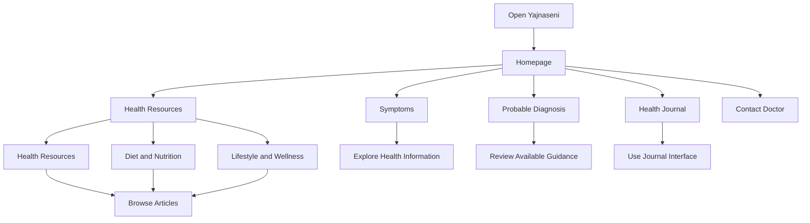
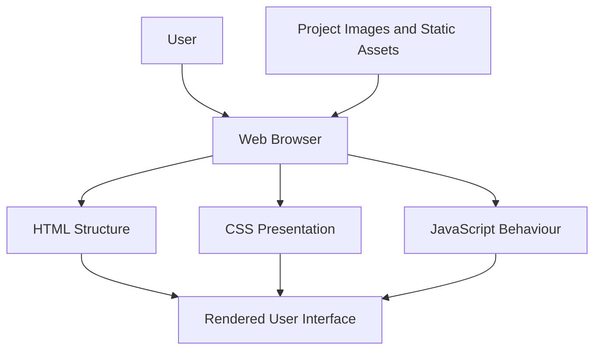
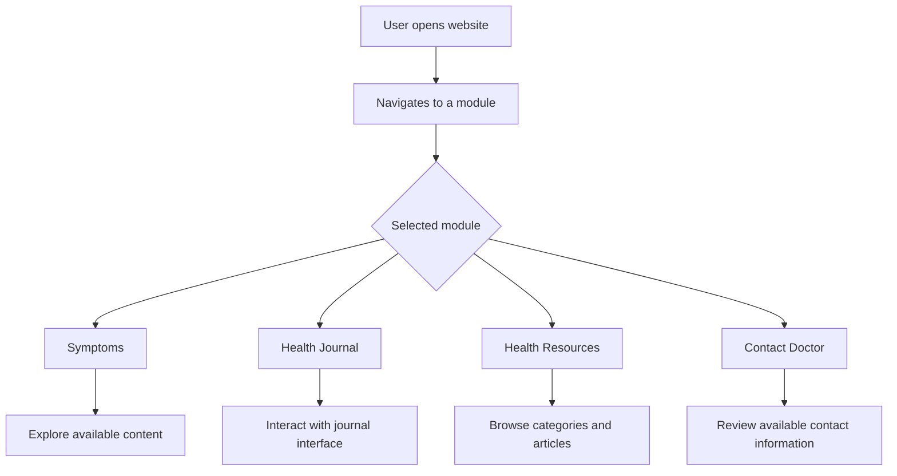
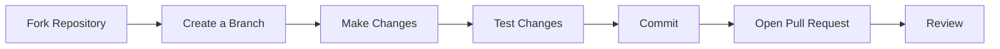

# Yajnaseni — Your Health, Your Strength

<p align="center">
  <strong>A Women's Health & Wellness Platform</strong>
  <br />
  Making health information more approachable through a thoughtfully designed digital experience.
</p>

<p align="center">
  
  
  
  
</p>

---

## Table of Contents

- [Overview](#overview)
- [Product Modules](#product-modules)
- [User Journey](#user-journey)
- [System Architecture](#system-architecture)
- [Technology Stack](#technology-stack)
- [Project Structure](#project-structure)
- [Getting Started](#getting-started)
- [Application Workflow](#application-workflow)
- [Data and API Usage](#data-and-api-usage)
- [Design Philosophy](#design-philosophy)
- [Roadmap](#roadmap)
- [Contributing](#contributing)
- [Responsible Use](#responsible-use)
- [License](#license)

---

## Overview

**Yajnaseni — Your Health, Your Strength** is a women's health and wellness website designed to bring health information, symptom exploration, personal journaling, and educational resources together in one accessible interface.

The project organizes related information into dedicated modules, allowing users to explore health topics, navigate wellness resources, and interact with the website through a consistent user interface.

### Project Objectives

- Make women's health information easier to explore.
- Organize wellness resources into clearly defined categories.
- Provide a dedicated space for personal health journaling.
- Create a consistent, approachable, and responsive user experience.
- Build a foundation for future enhancements in accessibility and multilingual support.

---

## Product Modules

| Module | Purpose | User Experience |
|---|---|---|
| Home | Introduces the platform | Explore the website and navigate to its modules |
| Symptoms | Presents women's health symptom information | Browse relevant health topics |
| Probable Diagnosis | Provides the project's symptom-related guidance interface | Explore the functionality implemented in the application |
| Health Journal | Supports personal health journaling | Interact with the journal interface |
| Health Resources | Organizes educational health content | Browse health information and articles |
| Diet & Nutrition | Focuses on nutrition-related resources | Explore nutrition content |
| Lifestyle & Wellness | Groups lifestyle and self-care content | Browse wellness topics |
| Contact Doctor | Provides a healthcare-contact information section | Explore available contact information and options |

*The table describes the intended role of each module. The exact functionality depends on the current implementation.*

---

## User Journey

The following diagram illustrates a high-level navigation journey through Yajnaseni.



*This is a conceptual navigation diagram; it does not imply that separate modules share data or that diagnosis results are medically validated.*

---

## System Architecture

Yajnaseni is developed as a web application. The following diagram shows a conceptual frontend architecture for the HTML, CSS, and JavaScript implementation.



### Architecture Components

| Component | Responsibility |
|---|---|
| HTML | Defines page structure and content |
| CSS | Controls layout, styling, and visual presentation |
| JavaScript | Implements client-side interactions where present |
| Static assets | Provide images and other local resources |
| Browser | Renders the application and handles user interactions |

*This diagram is a conceptual frontend model, not a verified representation of every dependency or runtime behaviour.*

---

## Technology Stack

| Technology | Role |
|---|---|
| HTML5 | Page structure and content |
| CSS3 | Styling, layout, and responsive presentation |
| JavaScript | Interactive behaviour and dynamic interface functionality |
| Git | Version control |
| GitHub | Source-code hosting |

The stack above reflects the project's intended core technologies and repository workflow. Verify the actual source files and configuration before treating every item as confirmed implementation detail.

---

## Project Structure

The project is maintained in the `Shakhthi` folder.

```text
Shakhthi/
├── index.html
├── styles.css
├── README.md
└── image/
```

The tree above is illustrative, not a verified complete directory listing. Update it to match the actual repository, including the real HTML, CSS, JavaScript, and asset filenames.

---

## Getting Started

### Prerequisites

- A modern web browser
- Visual Studio Code or another code editor
- Python 3, or another local static HTTP server

### 1. Clone the repository

```bash
git clone https://github.com/Maanya1-tech/Yajnaseni-Your-Health-Your-Strength.git
```

### 2. Open the project

```bash
cd Yajnaseni-Your-Health-Your-Strength
```

### 3. Start a local server

If Python 3 is installed, run:

```bash
python -m http.server 8000
```

On Windows, this command may also work:

```powershell
py -m http.server 8000
```

### 4. Open the website

Visit:

```text
http://localhost:8000
```

If the project uses a different entry point or requires a different startup process, follow the instructions appropriate to the actual project structure.

---

## Application Workflow

At a high level, the application presents health and wellness modules through a common navigation interface.



This diagram represents a high-level user journey, not an assertion that every workflow has been tested.

---

## Data and API Usage

The use of external APIs, persistent storage, or backend services must be established from the source code.

| Area | What to verify |
|---|---|
| Content | Whether information is stored in HTML, JavaScript, or separate data files |
| Images | Whether assets are loaded from local project folders or external URLs |
| Journal | Whether entries are stored temporarily, in browser storage, or on a server |
| External APIs | Whether JavaScript makes network requests to external services |
| Backend | Whether the application communicates with a server or database |

Do not assume that the website uses a backend, external API, or database without confirming it in the code.

---

## Design Philosophy

Yajnaseni follows a warm, approachable visual direction intended to make health-related information easier to navigate.

- **Visual identity:** Burgundy, blush, and cream tones.
- **Content organization:** Dedicated modules for different health and wellness topics.
- **Navigation:** Clearly labelled sections and category-based browsing.
- **User experience:** A consistent presentation across the website.

Specific accessibility and responsive-design capabilities should be verified against the current implementation.

---

## Roadmap

Potential future improvements include:

- [ ] Complete multilingual support for English, Kannada, Tamil, Telugu, Hindi, Malayalam, and Marathi.
- [ ] Review accessibility and keyboard navigation.
- [ ] Validate responsive behaviour across common screen sizes.
- [ ] Add verified application screenshots to the documentation.
- [ ] Expand automated testing and quality checks.
- [ ] Improve documentation as the application evolves.

These are proposed improvements, not claims of completed functionality.

---

## Contributing

Contributions can help improve the clarity, usability, and maintainability of Yajnaseni.



Suggested workflow:

1. Fork the repository.
2. Create a branch for your changes.
3. Make focused updates.
4. Test the affected functionality.
5. Commit your changes with a descriptive message.
6. Submit a pull request explaining the change.

---

## Responsible Use

Yajnaseni is an informational web project. Its content and interfaces should not be treated as a substitute for professional medical advice, diagnosis, or treatment.

Users should consult a qualified healthcare professional for personal medical concerns. Symptom-related guidance should not be represented as a confirmed medical diagnosis.

---

## License

No license is specified in this documentation. Check the repository for an existing `LICENSE` file before adding or claiming a license.

---

<p align="center">
  <strong>Yajnaseni — Your Health, Your Strength</strong>
  <br />
  <sub>Building a more approachable digital experience for women's health and wellness.</sub>
</p>
